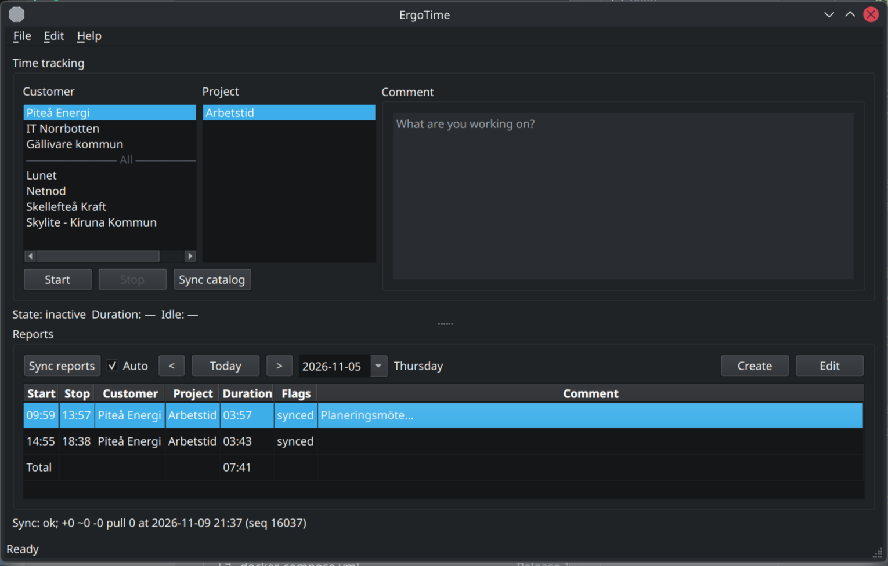

# ErgoTime client (C++ / Qt 6)

Official desktop client. Release notes are in [CHANGELOG.md](CHANGELOG.md). License: [GPLv3](LICENSE).

Desktop time tracker. It uses the same data directory as the Go client, `~/.ergotime2`, including `config.json` and `ergotime.db`, and the same HTTP sync protocol.



| Layer    | Technology                                                                                                                               |
| -------- | ---------------------------------------------------------------------------------------------------------------------------------------- |
| UI       | Qt 6 Widgets, including the system tray                                                                                                  |
| Local DB | SQLite through `Qt Sql` (`QSQLITE`)                                                                                                      |
| Sync     | `Qt Network`, HTTP Basic Auth. Sync runs only when `/healthz` advertises protocol 1.                                                     |
| Idle     | Linux: Wayland `ext-idle-notifier-v1`, then GNOME Mutter `IdleMonitor`, then `org.freedesktop.ScreenSaver`. Windows: `GetLastInputInfo`. |

On Linux the Wayland backend covers KWin, Sway, Hyprland, niri, labwc, and river. It subscribes to input idle (`get_input_idle_notification` when the compositor offers version 2) with a 500 ms threshold and reconstructs idle time from the `idled` and `resumed` events. GNOME Mutter does not implement that protocol, so the client falls back to Mutter `IdleMonitor`, then `org.freedesktop.ScreenSaver`. If none of those probes succeed, idle time stays at zero and the idle timeout does not stop a running report. macOS idle time stays at zero.

## Build

Qt 6.12, with Widgets, Sql, and Network. On Linux, DBus is used when Qt6 DBus is installed. CMake requires 6.12 or newer. Point every platform at the same 6.12 release:

```bash
cmake -S . -B build -DCMAKE_PREFIX_PATH="$HOME/Qt/6.12.0/gcc_64"
cmake --build build
./build/ergotime
```

Use the same version on Windows (`msvc*_64`), macOS (`macos`), and Android. This tree does not download Qt. The newest published build is **6.12.0** (6.12.1 is not on the official download server yet).

If CMake is not installed, `make` builds with `pkg-config` against `$HOME/Qt/6.12.0/gcc_64` (override `QT_PREFIX` and `CXX`). Output is `build/ergotime`. Linux desktop Qt 6.12.0 can be installed with:

```bash
aqt install-qt linux desktop 6.12.0 linux_gcc_64 -O "$HOME/Qt" --archives qtbase icu
```

The `icu` archive is required. That kit is linked against ICU 73 (`libicu*.so.73`), which is not part of `qtbase`.

## Static binary

`make` produces `build/ergotime`, which loads Qt from `$HOME/Qt/6.12.0/gcc_64/lib`. A static binary links the Qt archives into `build/ergotime-static` and does not depend on `libQt6*.so` or ICU. X11, OpenGL, fonts, D-Bus, and OpenSSL stay shared system libraries, because a fully static GUI executable cannot talk to the host display.

Official Qt downloads do not ship those archives. `scripts/install-qt-static.sh` builds qtbase 6.12.0 with SQLite included and installs it to `$HOME/Qt/static/6.12.0`. That needs CMake and the X11 development packages. Podman (or Docker) provides them:

```bash
make static-container    # image + static Qt + build/ergotime-static
make static              # rebuild the binary once the static Qt exists
```

`ldd build/ergotime-static` should list system libraries only. The static Qt build includes the Wayland platform plugin as well as XCB, so a Wayland session does not have to fall back to XWayland.

`make static` and `make static-windows` strip the binary and pack it with UPX (`scripts/pack-upx.sh`). The file stays an executable. The macOS CMake build does the same. UPX has to be installed (`upx` on Fedora, `brew install upx` on macOS).

## Windows cross-compile

A container is the way to cross-compile the Windows binary from Linux. The image holds the MinGW toolchain and a static Qt built with that compiler. The Linux 6.12 kit supplies `moc`. The result is `build/ergotime.exe`, linked against `$HOME/Qt/static/6.12.0-mingw`, and it still uses Windows system DLLs such as `USER32` and `OPENGL32`.

```bash
make static-windows-container
```

The aqt Windows kits are shared libraries, and the MSVC kit does not run on Linux. The Go client's miqt-docker image is a Qt 6.8 Go build, so this tree does not use it.

## macOS static build

Build on a Mac with CMake 3.25+, Ninja, and the Xcode command-line tools. `scripts/install-qt-static.sh` builds a static qtbase (Cocoa, SecureTransport, no frameworks) into `$HOME/Qt/static/6.12.0`:

```bash
./scripts/install-qt-static.sh
cmake -S . -B build -DCMAKE_BUILD_TYPE=Release -DERGOTIME_STATIC=ON \
  -DQT_STATIC_PREFIX="$HOME/Qt/static/6.12.0"
cmake --build build
```

The binary is `build/ergotime`. Idle time stays at zero on macOS.

## CI

GitHub Actions (`.github/workflows/build.yml`) builds the three static binaries on every push to `main` and on pull requests:

| Artifact                 | Runner                         |
| ------------------------ | ------------------------------ |
| `ergotime-linux-amd64`   | Ubuntu, Fedora container       |
| `ergotime-windows-amd64` | Ubuntu, MinGW cross-compile    |
| `ergotime-macos-arm64`   | `macos-latest` (Apple Silicon) |

A tag `v*` also publishes those files on a GitHub release. The first run compiles Qt from source and takes a long time. Later runs reuse the cached static prefix.

## What it does

- Customer and project lists, with the five most recently used customers pinned
- Start / stop, comment on the running report, hide-to-tray, tray menu to start a project
- Local reports for the selected day, create / edit / delete
- Catalog sync and report sync (batch push, per-report fallback, seq pull, local-wins conflict flag)
- Settings dialog written back to the shared `config.json`
